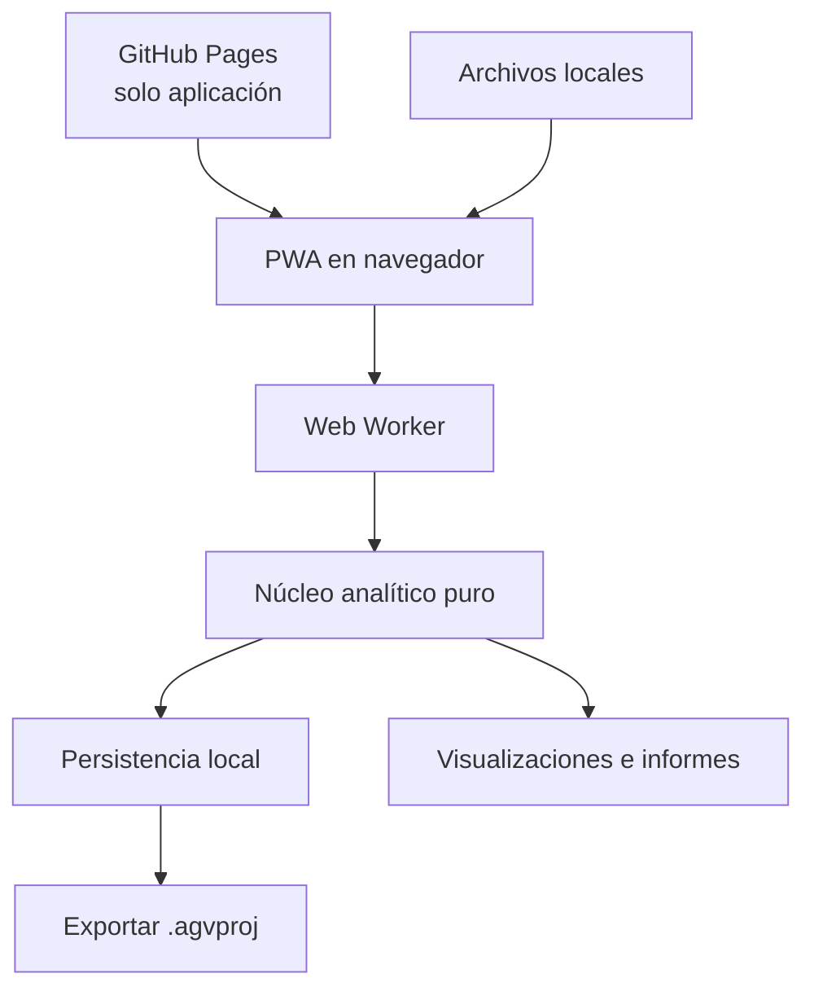
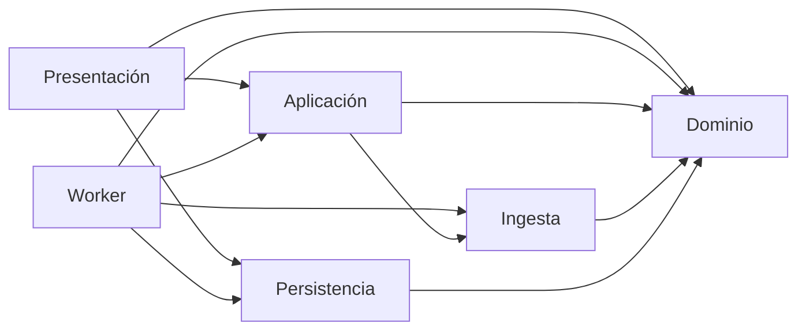

# Arquitectura

## 1. Decisión de alto nivel

TAG TRACE es una aplicación web estática/PWA servida desde GitHub Pages. El navegador descarga el código, pero los datos industriales se importan, procesan y persisten localmente. No existe backend de análisis ni sincronización automática.



## 2. Capas

Cinco carpetas en `src/` y una en `workers/`. Cada una tiene una responsabilidad y una lista de lo que no conoce; `tests/unit/layering.test.ts` comprueba las dependencias en cada ejecución.

| Capa | Carpeta | Responsabilidad | No conoce |
|---|---|---|---|
| Dominio | `src/domain/` (64 módulos) | Reglas puras: tiempo y zona horaria, grafo y vueltas, matriz de lecturas, calles, flujo y línea, incidencias y expedientes, instantáneas, memoria y consolidación, plano, valores de planta | DOM, ficheros, IndexedDB, Worker; solo importa dominio |
| Ingesta | `src/ingestion/` | Parseo CSV/XLSX, listas, historial de flota, registro de conexiones, procedencia | Visualización, almacén |
| Aplicación | `src/application/` | El protocolo UI↔Worker (`protocol.ts`), el ensamblado de instantáneas, las columnas de lectura, el banco de medida | DOM, almacén |
| Persistencia | `src/persistence/` | IndexedDB (`store.ts`, con sus migraciones), `.agvproj` (zip + JSON), lectores xlsx/zip propios | Reglas de negocio; solo importa dominio |
| Presentación | `src/presentation/` | Página, pestañas, paneles, gráficos en canvas/SVG, informes; DOM directo sin framework | Ingesta y Worker como módulo (solo lo arranca) |
| Worker | `workers/import.worker.ts` | Ejecuta todo el cálculo: un mensaje por trabajo, doce familias (`runImport`, `runMemory`, `runPlan`, `runCase`…); lee y escribe el almacén | Presentación |

Los contextos que la línea base de F0 llamaba `topology`, `analysis`, `incidents` y `consolidation` existen como módulos dentro de `src/domain/`, no como carpetas.

## 3. Dependencias permitidas



Lo que se exige y se comprueba:

- El dominio solo importa dominio; ni dominio ni aplicación tocan `document`, `indexedDB`, `postMessage`, `Worker` ni red. Esto permite probar algoritmos sin navegador y cambiar interfaz o persistencia sin reescribir el diagnóstico.
- La presentación no importa la ingesta ni el Worker como módulo, y no tiene ningún camino de repuesto que recalcule en el hilo principal (WP-001, WP-002).
- El Worker no importa la presentación.
- La presentación importa dominio y persistencia para formatear, nombrar y abrir o guardar lo que ya calculó el Worker; no para calcular.

Deuda conocida: `importer.ts` importa tres tipos de `protocol.ts` (una inversión leve que se resuelve moviéndolos al dominio) y el lector `.xlsx` vive en `persistence/` aunque sea ingesta.

## 4. Flujo de datos

1. La UI entrega el `File` al Worker con un identificador de trabajo.
2. El Worker calcula el hash y procesa por bloques.
3. La normalización produce columnas compactas y un registro de procedencia.
4. Las etapas analíticas consumen resultados anteriores sin duplicarlos.
5. El Worker publica progreso, métricas y resultados serializables (`WORKER_PROTOCOL.md`).
6. La UI conserva solo lo necesario para la vista actual.
7. Consolidación y persistencia escriben una nueva versión transaccional.

## 5. Memoria de ejecución

Reglas arquitectónicas:

- Parseo incremental; evitar `split` completo de archivos grandes.
- Representación columnar, diccionarios de IDs y arrays tipados cuando las mediciones lo justifiquen.
- Transferir buffers entre Worker y UI en lugar de clonarlos.
- Índices creados por necesidad y liberados al terminar una etapa.
- Agregados por contexto, no objetos JS repetidos por evento.
- Replay calculado por puntos de cambio; no guardar una posición por AGV y fotograma.
- Cancelación cooperativa con puntos de control deterministas.
- Resultados parciales marcados como incompletos y nunca consolidables.

## 6. Persistencia

- IndexedDB (`src/persistence/store.ts`) para circuitos, lecturas retenidas, instantáneas, memoria y versiones, plano, valores de planta, expedientes y revisiones, con migraciones numeradas.
- `.agvproj` (`src/persistence/agvproj.ts`) como formato portable independiente del almacenamiento interno: un zip con secciones JSON y esquema versionado (ADR-0012).
- OPFS y las bases embebidas (DuckDB-Wasm u otras) no se han necesitado; se fijarían solo tras demostrar con medida una reducción neta de complejidad o recursos.

## 7. Stack

| Área | En uso | Decisión |
|---|---|---|
| Lenguaje | TypeScript estricto (`strict`, `noUncheckedIndexedAccess`, `exactOptionalPropertyTypes`) | ADR-0009 |
| Build/PWA | Vite + service worker propio, sellado al compilar con su versión y su lista de ficheros | ADR-0009, 3.82.0 |
| UI | DOM directo, sin framework | ADR-0009 (OQ-P05) |
| Unitarias y auditoría | Vitest | ADR-0009 |
| Navegador | Playwright, con axe-core solo en pruebas | ADR-0009, OQ-175 |
| Gráficos | Canvas y SVG propios, sin librería | OQ-P04 |
| Persistencia | IndexedDB | ADR-0012 |
| CI/CD | GitHub Actions + GitHub Pages | ADR-0014 |

No hay dependencias de ejecución: los dos bundles publicados son código propio. Toda dependencia de desarrollo se fija en el `package-lock.json` y se audita (`SECURITY_PRIVACY.md` §9).

## 8. Estructura

```text
src/
  domain/         reglas puras
  ingestion/      parseo y normalización
  application/    protocolo UI↔Worker y ensamblado
  persistence/    IndexedDB y .agvproj
  presentation/   página, paneles, gráficos, informes
workers/
  import.worker.ts
schemas/          esquemas JSON (project_state, .agvproj)
fixtures/synthetic/
tests/
  unit/           Vitest, por módulo
  audit/          circuito sintético con verdad plantada, informe por clase de fallo
  e2e/            Playwright sobre `dist`
  support/        constructores de fixtures para las pruebas
```

## 9. Determinismo

Los algoritmos no consultan reloj, red, orden no estable ni aleatoriedad sin semilla. El hash semántico excluye únicamente metadatos declarados no deterministas. Una reproducción conserva exactamente entrada, configuración, calendario, reglas y versiones.

## 10. Publicación y actualización

- Solo una compilación aprobada se despliega desde `main`.
- La publicación contiene código y fixtures sintéticos, nunca datos locales.
- El Service Worker no activa una versión mientras haya una operación crítica: la versión nueva
  espera y la activa la persona (3.82.0, `UX_SPEC.md` §9).
- Cada release incluye identificador visible y posibilidad de volver a la compilación anterior
  (etiqueta `vX.Y.Z` y retorno desde el workflow, `VERSIONING.md` §Publicación y retorno).
- La aplicación no depende en ejecución de CDN de terceros (`connect-src 'none'`).
