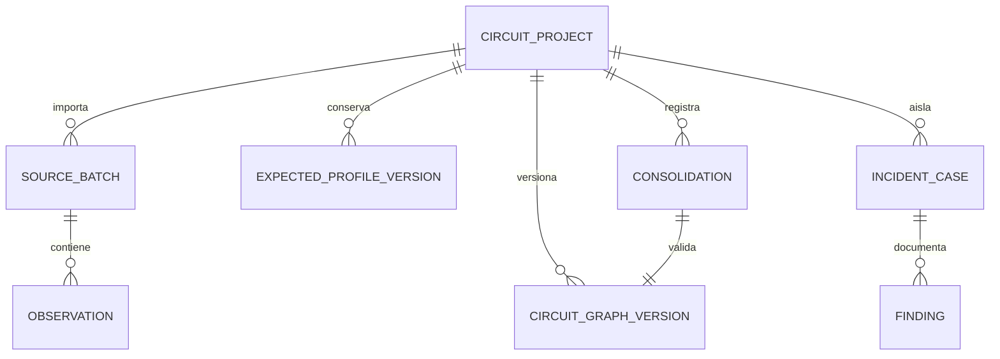
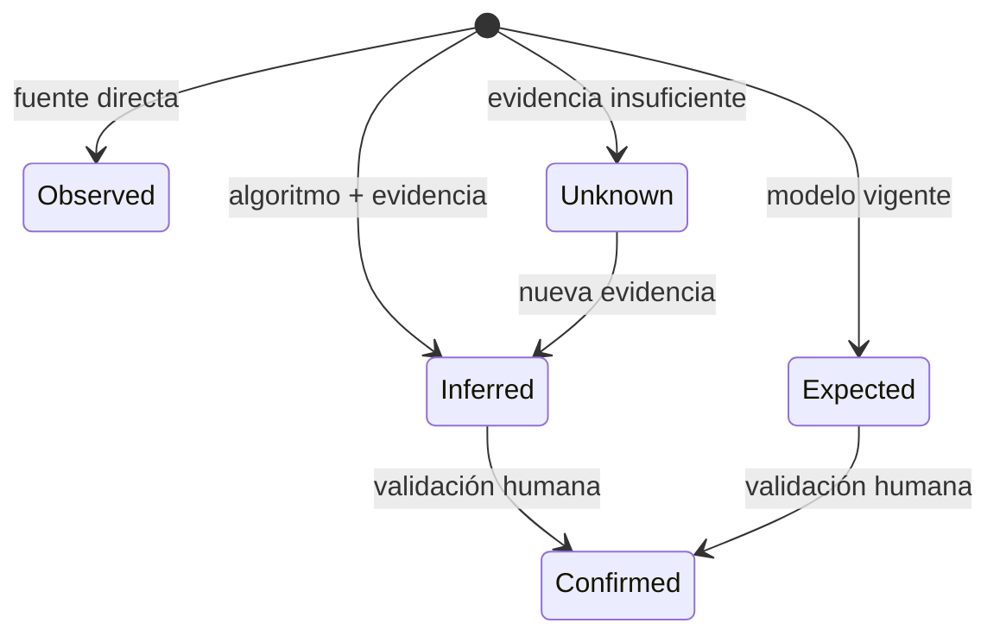

# Modelo de dominio

Este documento describe el **modelo conceptual** escrito en F0. Los nombres de los agregados de abajo
(`CircuitProject`, `SourceBatch`, `CircuitGraphVersion`…) son conceptos, no tipos del código: dónde vive
cada uno en `src/` lo dice la sección [Del concepto al código](#del-concepto-al-código), al final.

## Agregados principales

### CircuitProject

Raíz de aislamiento. Contiene identidad del circuito, configuraciones versionadas, catálogo parcial, memoria consolidada, expedientes de incidencia y referencias a fuentes. Ningún objeto operativo puede pertenecer implícitamente a dos circuitos.

### SourceBatch

Fuente importada con `source_id`, tipo, nombre local sanitizado, hash, tamaño, periodo, esquema detectado, zona horaria, recuentos, advertencias y estado de aceptación. El contenido bruto permanece inmutable durante la sesión.

### Observation

Evento normalizado que conserva:

- `timestamp` y representación original;
- `agv_id` y `tag_id` como texto;
- atributos disponibles sin inventar campos ausentes;
- `source_id`, número de fila y hash;
- estado `observed`.

### CircuitGraphVersion

Versión de nodos y transiciones con procedencia:

- teórica/configurada;
- observada en un periodo;
- inferida por algoritmo;
- validada mediante consolidación.

Cada arista conserva soporte, AGV participantes, primera/última observación, distribución robusta de tiempo, contextos y confianza.

### ExpectedProfileVersion

Describe el comportamiento esperado para un contexto: vigencia, calendario, turno, pausa, estado de proceso, zona, tipo de AGV/configuración y versión del grafo. No es un promedio universal.

### Finding

Conclusión provisional o aceptada con:

- categoría y objeto afectado;
- estado de verdad;
- evidencia a favor y en contra;
- algoritmo/regla y versión;
- confianza e impacto separados;
- diagnósticos alternativos;
- comprobación recomendada;
- disposición: pendiente, aceptado, rechazado, excluido o vinculado a incidencia.

### Consolidation

Evento append-only que transforma un análisis revisado en una nueva versión de memoria. Registra autor, instante, periodo, fuentes, configuración, algoritmos, inclusiones/exclusiones, justificaciones, hash anterior y hash resultante.

### IncidentCase

Expediente separado con síntoma, intervalo y márgenes, eventos normalizados necesarios para el replay, esperado aplicable, divergencias, hipótesis, evidencia, contramedidas y verificaciones.

## Relaciones

## Máquina de estados de evidencia

Una entidad puede evolucionar de hipótesis a confirmación, pero nunca se reescribe su procedencia:

`confirmed` añade una decisión humana; no convierte retrospectivamente una inferencia en lectura observada.

## Contextos que no deben mezclarse

- Circuitos diferentes.
- Multicircuitos distintos dentro de un mismo circuito: cambian el comportamiento al leer un tag y
  pueden cambiar las condiciones físicas de detección, así que sus lecturas no son comparables.
- Periodos con multicircuito conocido y periodos en los que se desconoce.
- Zona cargada y zona vacía.
- Operación normal, pausas, parada planificada e incidencia.
- Versiones de configuración distintas.
- Familias de AGV/lector cuando su comportamiento difiera materialmente.
- Lectura directa e inferencia.
- Mantenimiento/asistencia y recorrido productivo.

## Del concepto al código

Revisado el 2026-10-18 (3.89.0) contra `src/`. Ninguno de los ocho nombres conceptuales es un tipo del
código (la interfaz privada `Observation` de `inventory.ts` es otra cosa); cada concepto se reparte entre
los tipos reales de la tabla. Los tipos de `src/domain` son puros
(sin navegador ni almacén, `layering.test.ts`); los `Stored*` son la forma en que `src/persistence`
los guarda en IndexedDB, y `src/application/protocol.ts` lo que el Worker entrega a la interfaz.

| Concepto (F0) | Tipo real | Módulo | Notas |
|---|---|---|---|
| `CircuitProject` | `StoredCircuit`, más las tablas del almacén con clave `circuitId` | `src/persistence/store.ts` | El registro del circuito guarda nombre, zona, fuentes, cobertura, listas, flota y conexiones; lecturas, instantáneas, memoria, plano, valores de planta y expedientes van en sus propias tablas. Borrar un circuito las vacía todas en una transacción. Su copia portable es el `.agvproj` (`src/persistence/agvproj.ts`, ADR-0012). |
| `SourceBatch` | `StoredSource`; `SourceSummary`; `SourceCoverage` | `src/persistence/store.ts`; `src/application/protocol.ts`; `src/domain/coverage.ts` | Huella (`sourceHash`), nombre, filas aceptadas, tramo completo (R-DAT-007), si sus lecturas siguen retenidas (R-DAT-023) y si tiene instantánea. El original comprimido se archiva aparte (tabla `archive`); qué lecturas se retienen lo decide `src/persistence/retention.ts`. |
| `Observation` | `Reading` con `Provenance`; `QuarantinedRow` | `src/domain/reading.ts` | IDs como texto, `t_utc` con la cadena original (ADR-0013) y procedencia hasta fichero, hash y fila. Las filas rechazadas van a cuarentena con su código. |
| `CircuitGraphVersion` | `ObservedGraph` (un análisis); `CircuitSnapshot` (un fichero); `ConsolidatedVersion.snapshot` (validada) | `src/domain/graph.ts`; `src/domain/snapshot.ts`; `src/domain/memory.ts` | Lo «teórico o configurado» son las listas de planta (`StoredTagList`, `src/domain/tag-lists.ts`) y la configuración del circuito (`src/domain/circuit-config.ts`). Lo observado en un periodo es la instantánea por fichero (ADR-0015); lo validado, la instantánea elegida al consolidar. |
| `ExpectedProfileVersion` | `expectedOf(ConsolidatedVersion)` y `expectedSnapshot(...)`; `SnapshotSection` (horquilla por tramo y régimen) | `src/domain/memory.ts`; `src/domain/change-class.ts`; `src/domain/snapshot.ts` | El esperado es la instantánea de la versión vigente con solo los cambios colectivos y sostenidos o confirmados (OQ-146, OQ-147). La configuración con que se midió va en `CircuitSnapshot.configVersion`; los valores de planta confirmados, en `src/domain/plant-values.ts`. |
| `Finding` | Hallazgos tipados de `CircuitViews`; `SnapshotFinding`; `FindingKind`; `ReviewEntry` | `src/application/protocol.ts`; `src/domain/snapshot.ts`; `src/domain/finding-kinds.ts`; `src/domain/review.ts` | No hay un tipo único: cada familia de reglas produce el suyo en su módulo de `src/domain`. La clave de revisión, el tema y el rango están en `FINDING_KINDS`; la disposición (pendiente, confirmado, descartado, pospuesto) en `ReviewEntry` (R-EVI-007). |
| `Consolidation` | `ConsolidatedVersion` (con `MemoryDecision` y `CaseExclusion`); `LineageState` y `LineageEvent` | `src/domain/memory.ts`; `src/domain/consolidation-fingerprint.ts` | Versiones vN append-only encadenadas por hash; revocar no borra. El linaje y las bifurcaciones entre dispositivos están en `LineageState`; la huella de la previsualización, en `consolidation-fingerprint.ts` (ADR-0005). |
| `IncidentCase` | `CaseRevision` (con `CaseWindow`, `Hypothesis`, `HypothesisDecision`, `Countermeasure`, `Verification`); `FrozenEvidence` | `src/domain/incident-case.ts` y `case-*.ts`; `src/persistence/project-incidents.ts` | Revisiones append-only por hash y un recorte congelado de las lecturas de la ventana (ADR-0018). La **incidencia excluida** de F4, que no es un expediente, es `CaseExclusion` (`memory.ts`) e `IncidentCut` (`src/domain/incident-cut.ts`). |

### Agregados posteriores a este modelo

Llegaron después de F0 y no tienen agregado conceptual arriba:

| Agregado | Tipo real | Módulo | Decisión |
|---|---|---|---|
| Instantánea por fichero: lo que perdura de cada exportación cuando sus lecturas dejan de retenerse | `CircuitSnapshot`, `SnapshotDelta`; tabla `snapshots` | `src/domain/snapshot.ts`; `src/application/snapshot-assembly.ts` | ADR-0015 |
| Plano físico: ubicaciones estables distintas del tag instalado, que solo cambian por confirmación humana | `PhysicalPlan`, `PlanLocation`, `PlanEvent`; tabla `plan` | `src/domain/plan.ts`; `src/persistence/project-plan.ts` | ADR-0016 |
| Registro de conexiones del terminal (DS-013) y sus cortes | `ConnectionEvent`, `StoredConnections`; `ConnectionCut`, `ConnectionSummary` | `src/domain/connection-log.ts`; `src/domain/connection-cuts.ts`; `src/persistence/store.ts` | ADR-0017 |
| Listas de tags declaradas por planta (circuito, memoria, zona, críticos, área…) | `StoredTagList`, `StoredTagEntry`; `KNOWN_LISTS` | `src/persistence/store.ts`; `src/domain/tag-lists.ts` | `CONFIG_SCHEMA.md` §3.8 |
| Historial de flota (DS-012) | `FleetPeriod`, `StoredFleet` | `src/domain/fleet.ts`; `src/persistence/store.ts` | R-AGV-014, R-AGV-015 |
| Valores de planta confirmados por una persona | `PlantValueEvent`; tabla `plantValues` | `src/domain/plant-values.ts`; `src/persistence/project-plant-values.ts` | OQ-151 a OQ-153 |
| Expedientes de incidencia | `CaseRevision`, `FrozenEvidence`; tablas `incidentCases` e `incidentEvidence` | `src/domain/incident-case.ts`; `src/persistence/project-incidents.ts` | ADR-0018 |

El diagrama de relaciones de arriba sigue siendo el conceptual: la instantánea, el plano, las
conexiones, las listas, la flota y los valores de planta también cuelgan de un solo circuito y nunca
se comparten entre dos (ADR-0004).
